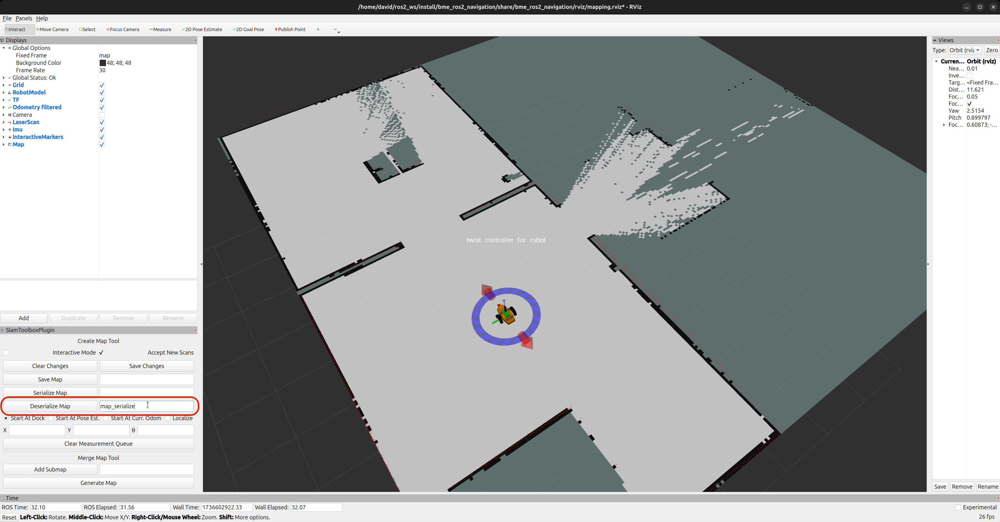
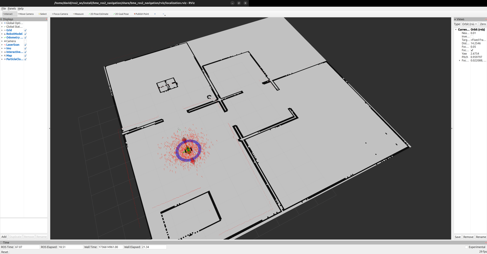
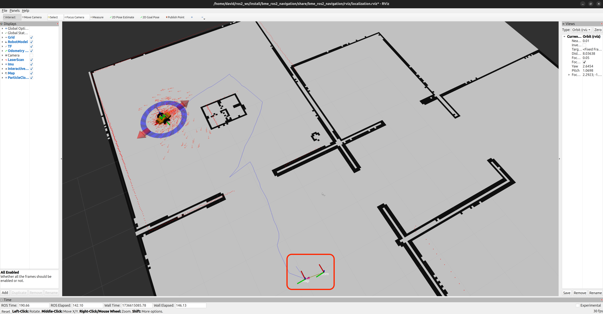
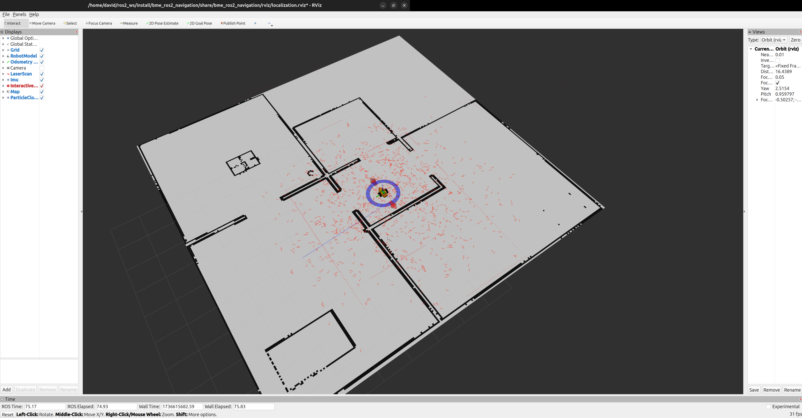
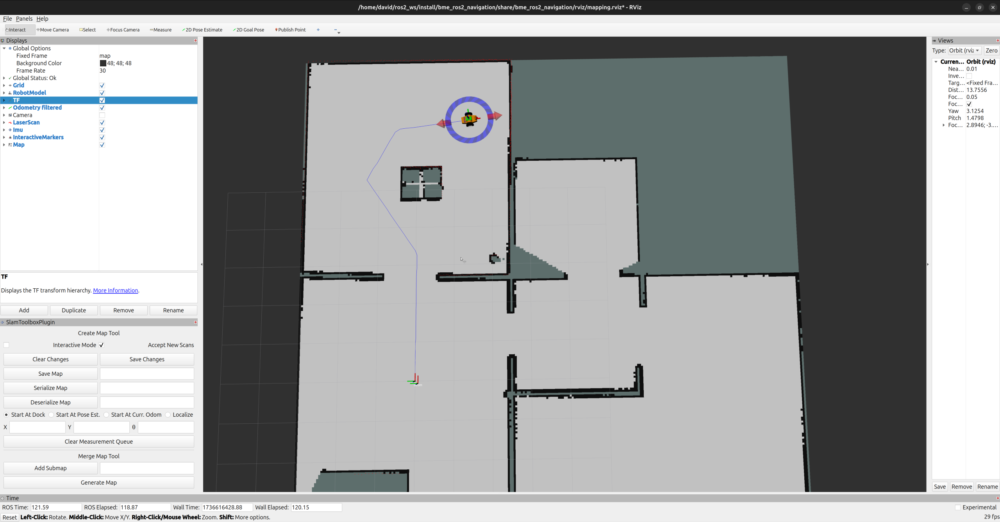
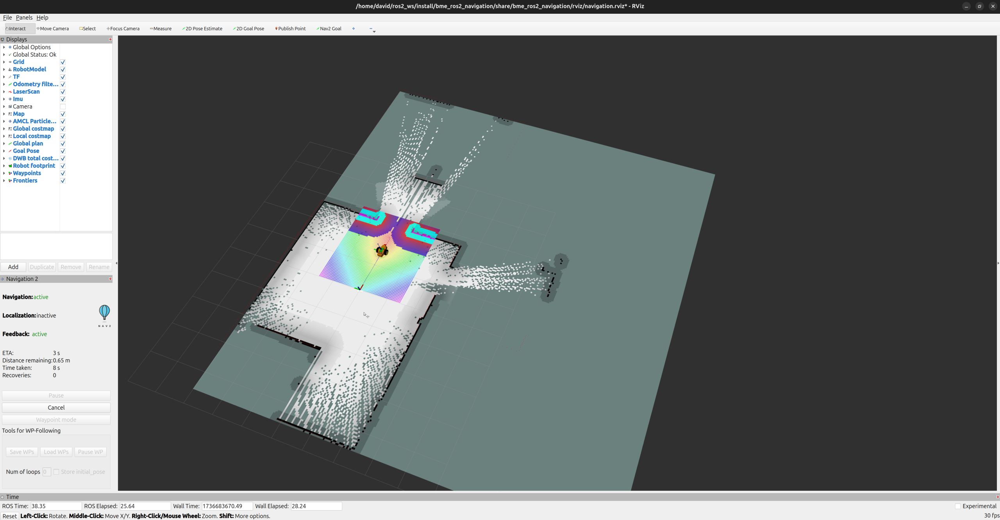
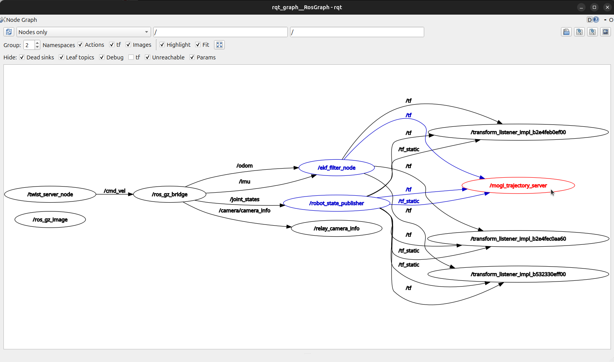
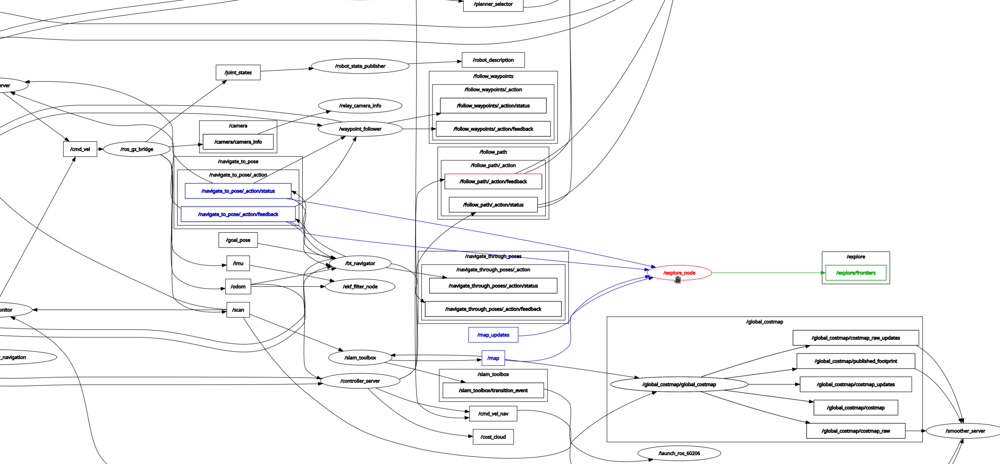
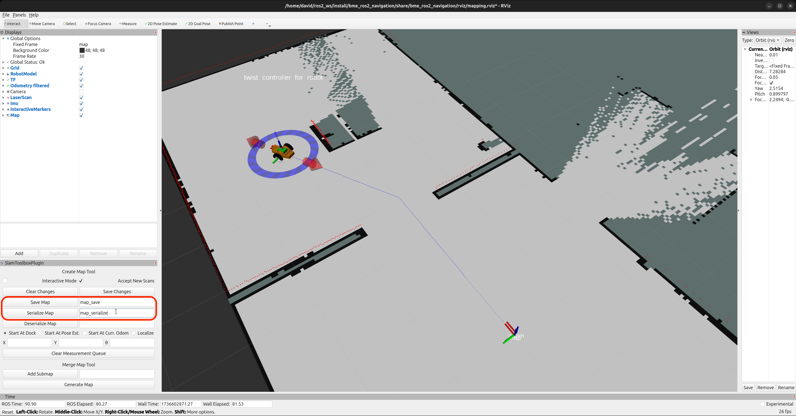

# Autonomous Mobile Robot (AMR) Navigation using ROS 2

### Simulation | SLAM | Autonomous Navigation | Nav2 | Gazebo

An autonomous mobile robot simulation project developed using **ROS 2 Humble**, **Gazebo**, **SLAM Toolbox**, and **Nav2**.

The project focuses on developing a differential-drive mobile robot capable of exploring an environment, building maps, estimating its position, and navigating toward target locations while avoiding obstacles.

The goal is to understand and implement the complete robotics navigation pipeline, integrating robot modeling, simulation, perception, localization, and autonomous motion planning.

---

### 1. Map Loading



### 2. Localization








### 4. SLAM Navigation


### 5. ROS Graph




### 6. Map Saving



## Project Objectives

- Develop a differential-drive autonomous mobile robot.
- Create a robot model using URDF and Xacro.
- Simulate the robot in a custom Gazebo environment.
- Integrate a 2D LiDAR sensor for environment perception.
- Implement mapping using SLAM Toolbox.
- Configure localization and navigation using ROS 2 Nav2.
- Enable autonomous movement and obstacle avoidance.
- Visualize robot behavior using RViz2.

---

## Technology Stack

| Category | Technologies |
|---|---|
| Robotics Middleware | ROS 2 Humble |
| Simulation | Gazebo |
| Navigation | Nav2 |
| Mapping | SLAM Toolbox |
| Visualization | RViz2 |
| Robot Description | URDF / Xacro |
| Programming | C++ / Python |
| Operating System | Ubuntu Linux |
| Build System | Colcon |

---

## Robot Specifications

| Component | Specification |
|---|---|
| Robot Type | Differential Drive Mobile Robot |
| Dimensions | 30 × 30 × 15 cm |
| Drive System | 2 Driven Wheels + 1 Caster |
| Wheel Diameter | 10 cm |
| Environment Sensor | 2D LiDAR |
| LiDAR Coverage | 360° |
| Maximum LiDAR Range | 12 m |
| LiDAR Frequency | 10 Hz |
| Odometry | Wheel Odometry |
| Velocity Control | `/cmd_vel` |

---

## System Architecture

The project is organized into three main ROS 2 packages.

### 1. `amr_bot_description`

Responsible for the robot's physical and sensor description.

- Robot chassis and wheel modeling.
- URDF/Xacro-based robot description.
- LiDAR sensor integration.
- Differential-drive configuration.
- Inertial properties and physical parameters.
- Robot State Publisher integration.

### 2. `amr_bot_gazebo`

Responsible for the simulation environment.

- Custom Gazebo world.
- Walls and obstacles.
- Robot spawning.
- Differential-drive simulation.
- LiDAR sensor simulation.
- Simulation launch configuration.

### 3. `amr_bot_navigation`

Responsible for mapping, localization, and autonomous navigation.

- SLAM Toolbox configuration.
- Nav2 navigation parameters.
- Costmap configuration.
- Planner and controller configuration.
- RViz2 visualization.
- Python-based navigation goal execution.

---

## Navigation Pipeline

The intended autonomous navigation workflow consists of:

1. **Robot Modeling:** Create the robot using URDF/Xacro.
2. **Simulation:** Spawn the robot inside the Gazebo environment.
3. **Perception:** Use LiDAR to detect surrounding obstacles.
4. **Mapping:** Build an environment map using SLAM Toolbox.
5. **Localization:** Estimate the robot's position within the map.
6. **Path Planning:** Calculate a route toward the target using Nav2.
7. **Motion Control:** Execute velocity commands through `/cmd_vel`.
8. **Obstacle Avoidance:** Use navigation costmaps and controllers to navigate around obstacles.

---

## Project Structure

```text
amr_nav_ws/
│
├── src/
│   ├── amr_bot_description/
│   │   ├── urdf/
│   │   │   ├── robot.urdf.xacro
│   │   │   ├── robot_core.xacro
│   │   │   ├── gazebo_control.xacro
│   │   │   ├── lidar.xacro
│   │   │   └── inertial_macros.xacro
│   │   └── launch/
│   │       └── rsp.launch.py
│   │
│   ├── amr_bot_gazebo/
│   │   ├── worlds/
│   │   │   └── obstacles.world
│   │   └── launch/
│   │       └── launch_sim.launch.py
│   │
│   └── amr_bot_navigation/
│       ├── config/
│       │   ├── nav2_params.yaml
│       │   ├── mapper_params_online_async.yaml
│       │   └── nav2_default_view.rviz
│       ├── launch/
│       │   ├── slam.launch.py
│       │   ├── navigation.launch.py
│       │   └── rviz.launch.py
│       ├── scripts/
│       │   └── send_goal.py
│       └── maps/
│
├── docs/
│   └── images/
│
├── setup_dependencies.sh
├── quick_start.sh
├── USAGE_GUIDE.md
└── README.md
```

---

## Installation and Quick Start

### Prerequisites

- Ubuntu Linux
- ROS 2 Humble
- Gazebo
- Nav2
- SLAM Toolbox
- Colcon build tools

### 1. Clone the Repository

```bash
git clone https://github.com/srinivasvenna1/amr_nav_ws.git
cd amr_nav_ws
```

### 2. Install Dependencies

Run the dependency installation script:

```bash
sudo ./setup_dependencies.sh
```

### 3. Build the Workspace

```bash
colcon build
```

Source the workspace:

```bash
source install/setup.bash
```

### 4. Launch the Robot

Use the interactive quick-start helper:

```bash
./quick_start.sh
```

For detailed launch instructions, refer to `USAGE_GUIDE.md`.

---

## Development Status

| Milestone | Status |
|---|---|
| ROS 2 Workspace Setup | Completed |
| Robot URDF/Xacro Model | Completed |
| Differential Drive Configuration | Completed |
| LiDAR Integration | Configured |
| Gazebo World Creation | Completed |
| SLAM Toolbox Configuration | Configured |
| Nav2 Configuration | Configured |
| RViz2 Visualization Setup | Completed |
| SLAM Mapping Test | Pending |
| Localization Testing | Pending |
| Autonomous Navigation Testing | Pending |
| Real Hardware Deployment | Future Work |

*Note: Configuration and integration milestones are distinguished from runtime testing. Navigation performance is still to be validated.*

---

## Future Improvements

- Complete SLAM mapping and localization validation.
- Test autonomous navigation in different environments.
- Tune Nav2 planner, controller, and costmap parameters.
- Integrate additional sensors such as cameras and IMU.
- Explore advanced path-planning algorithms.
- Improve obstacle detection and navigation performance.
- Deploy the navigation stack on physical robot hardware.

---

## Learning Resources

- [ROS 2 Humble Documentation](https://docs.ros.org/en/humble/)
- [Nav2 Documentation](https://navigation.ros.org/)
- [SLAM Toolbox](https://github.com/SteveMacenski/slam_toolbox)
- [Gazebo Documentation](https://gazebosim.org/docs)

---

## Author

**Srinivas Venna**

Mechanical Engineering | Robotics | Autonomous Systems

Interested in autonomous mobile robots, robot navigation, motion planning, SLAM, and intelligent robotic systems.

- GitHub: [srinivasvenna1](https://github.com/srinivasvenna1)
- Email: [srinivasraovenna1@gmail.com](mailto:srinivasraovenna1@gmail.com)

---

If you find this project interesting, feel free to explore the repository and follow its development.

**Exploring the intersection of mechanical engineering and intelligent autonomous systems.**

